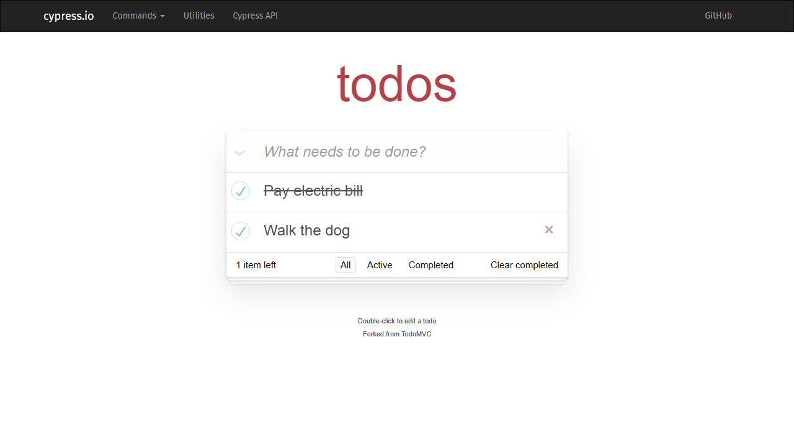

# Completing the second sample ToDo can update the first because IDs collide

**Status:** Published as [GitHub issue #1](https://github.com/andjeloed/todo-playwright-automation/issues/1). The user confirmed publication of the supplied issue text and uploaded screenshot. This local record retains the same technical content; the evidence image is linked locally here.

## Summary

The two initial sample tasks can receive the same ID when created in the same millisecond. Completing “Walk the dog” can therefore update “Pay electric bill” instead.

This is a defect in the upstream Cypress Kitchen Sink ToDo application, documented here as part of the QA assessment.

## Classification

- Type: Functional defect
- Priority: P1
- Severity: Major — the wrong task is modified

## Environment

- Application: http://localhost:8080/todo
- Upstream repository: https://github.com/cypress-io/cypress-example-kitchensink
- Application commit: dca70562c010156b05cc8b54e641f67c0063d5dc
- Browser: Chromium through Playwright 1.64.1
- Reproduced locally on Windows

## Preconditions

Use a fresh browser context with no `todos-vanillajs` localStorage entry.

The issue occurs when both sample tasks are generated in the same millisecond. Natural reproduction depends on timing.

## Steps to reproduce

1. Open http://localhost:8080/todo in a fresh browser context.
2. Confirm that “Pay electric bill” and “Walk the dog” appear.
3. Inspect the `.todo-list > li` elements and confirm that their `data-id` values match.
4. Select the checkbox beside “Walk the dog”.
5. Inspect both tasks and the value of `localStorage.getItem('todos-vanillajs')`.
6. Reload the page.

For deterministic automated reproduction, the linked regression uses Playwright’s `page.clock.setFixedTime` before navigation to ensure both sample IDs are generated in the same millisecond.

## Expected result

Only “Walk the dog” becomes completed.

Its checkbox, styling and stored completion state agree and survive reload. “Pay electric bill” remains active.

## Actual result

“Pay electric bill” becomes completed in storage and receives completed styling.

The clicked checkbox beside “Walk the dog” can appear checked while its row remains styled as active. After reload, the first task is completed and the second is active.

Observed stored state after selecting the second task:

```json
[
  {
    "title": "Pay electric bill",
    "completed": true,
    "id": 1793631541720
  },
  {
    "title": "Walk the dog",
    "completed": false,
    "id": 1793631541720
  }
]
```

## Impact

Users cannot reliably target a specific task when IDs collide. Completion, editing and deletion can affect the wrong task.

## Likely cause and proposed improvement

`Store.save` generates IDs using `new Date().getTime()`. The initial sample tasks are created synchronously, so their IDs can collide. Model updates and DOM lookups select the first matching ID.

Use collision-resistant IDs and update ID handling consistently throughout the model and view. Add product-level coverage for multiple tasks created in the same millisecond.

## Evidence

[Automated reproduction](https://github.com/andjeloed/todo-playwright-automation/blob/main/tests/todo-known-defect.spec.ts)

[Published Allure report](https://andjeloed.github.io/todo-playwright-automation/)



The regression is marked as an acknowledged expected failure. A passing automation run does not indicate that this product defect has been fixed.

## Acceptance criteria

- Tasks created in the same millisecond receive distinct IDs.
- Completing, editing or deleting one sample task leaves the other unchanged.
- UI and stored state agree before and after reload.
- After the fix is verified, remove the regression’s expected-failure annotation.
